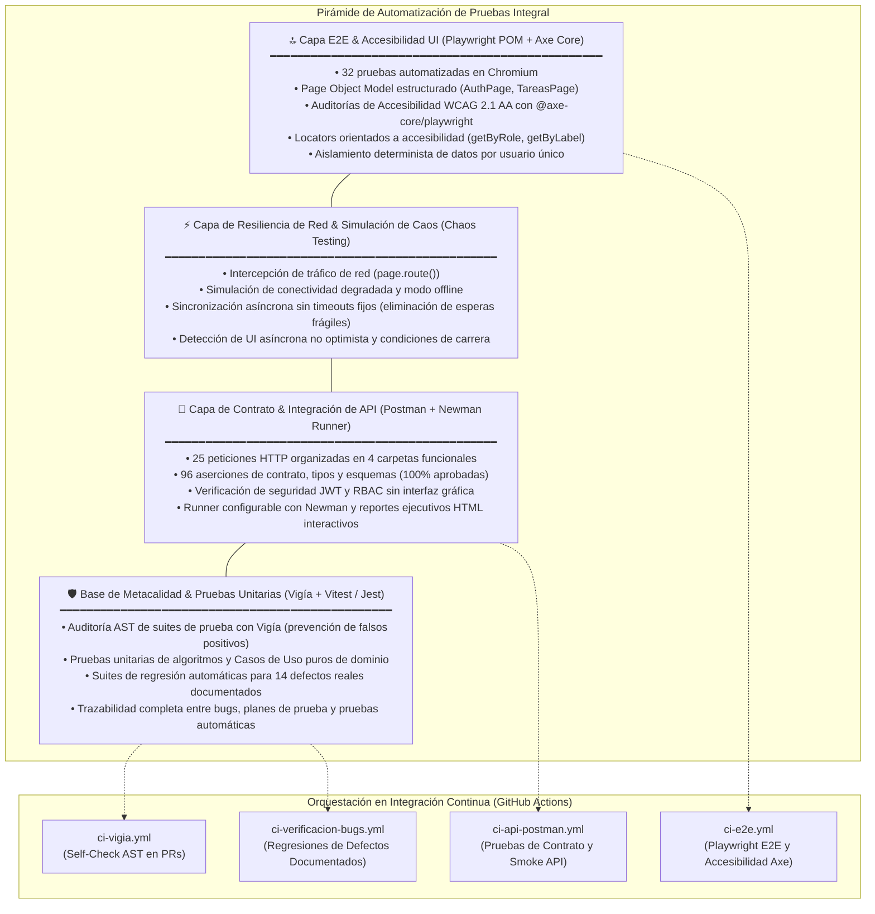

# Automatizacion E2E

Suite de pruebas extremo a extremo con Playwright sobre el
[gestor de tareas](https://github.com/eduardo-mr1/proyectos-de-programacion):
API en Node/Express + cliente en React.

32 pruebas cubriendo accesibilidad WCAG 2.1 AA, autenticacion, CRUD de tareas, no-regresion y aislamiento entre usuarios.

## Por que la app bajo prueba vive en otro repositorio

Es el patron habitual en equipos de QA: el repositorio de pruebas es
independiente del de la aplicacion, para que la suite pueda evolucionar y
ejecutarse sin tocar el codigo de producto. El workflow de CI hace checkout de
ambos repositorios, levanta la aplicacion y corre las pruebas contra ella.

## Como correrlo en local

Necesitas la aplicacion corriendo. En dos terminales:

```bash
# terminal 1 - API
cd ../proyectos-de-programacion/api-gestor-tareas
npm install && npm start          # http://localhost:3000

# terminal 2 - frontend
cd ../proyectos-de-programacion/frontend-gestor-tareas
npm install && npm run dev        # http://localhost:5173
```

Y despues:

```bash
npm install
npx playwright install chromium
npm test                # modo headless
npm run test:headed     # viendo el navegador
npm run report          # abre el reporte HTML de la ultima corrida
```

Si sirves la app en otros puertos, pasa `APP_URL`:

```bash
APP_URL=http://localhost:4173 npm test
```

## Que se prueba

| Archivo | Cobertura |
|---|---|
| `tests/accesibilidad.spec.js` | Auditorías completas con `@axe-core/playwright` bajo estándares WCAG 2.1 AA (contraste de color, roles ARIA y semántica, navegación 100% por teclado y formularios accesibles) |
| `tests/autenticacion.spec.js` | Registro, login, logout, credenciales invalidas, email duplicado, persistencia de sesion |
| `tests/tareas.spec.js` | Crear, completar, descompletar, eliminar, contador de pendientes, persistencia, aislamiento entre usuarios |
| `tests/regresiones-ui.spec.js` | No-regresión en UI: desborde de títulos largos (BUG-003) y actualización reactiva inmediata de checkbox (BUG-008) |

La prueba funcional mas importante es el aislamiento: **un usuario no ve las tareas de otro**.
La API ya lo verifica a nivel de integracion, pero esta lo confirma desde la
interfaz, que es donde el usuario real lo experimenta.

---

## 🏛️ Pirámide de Pruebas & Arquitectura de QA

> 📖 **Documentación de arquitectura:** Consulta [docs/arquitectura/README.md](../docs/arquitectura/README.md) y [docs/arquitectura/automatizacion-e2e-testing-pyramid.md](../docs/arquitectura/automatizacion-e2e-testing-pyramid.md) para la estrategia integral de calidad y tolerancia a fallos.



---

## Arquitectura: Page Object Model (POM)

La suite implementa el patrón **Page Object Model (POM)** para desacoplar las interacciones con la interfaz de las aserciones de prueba:

```
automatizacion-e2e/
├── pages/
│   ├── AuthPage.js           # Encapsula selectores y acciones de Login / Registro
│   ├── TareasPage.js         # Encapsula selectores y acciones de la lista de tareas
│   └── index.js              # Punto de entrada unificado de los Page Objects
├── tests/
│   ├── accesibilidad.spec.js # Auditorías A11y con @axe-core/playwright (WCAG 2.1 AA)
│   ├── autenticacion.spec.js # Casos E2E de auth usando AuthPage y TareasPage
│   ├── tareas.spec.js        # Casos E2E de gestión de tareas usando TareasPage
│   ├── regresiones-ui.spec.js# Pruebas de no-regresión de interfaz
│   ├── fixtures/
│   │   └── a11y.js           # Fixture reutilizable con tags WCAG 2.1 AA y AxeBuilder
│   └── helpers.js            # Funciones auxiliares y reexport de fixtures
└── playwright.config.js
```

### Ventajas del patrón POM implementado:
1. **Mantenibilidad:** Si un selector o etiqueta cambia en el frontend, solo se actualiza en el Page Object correspondiente sin tocar los specs.
2. **Legibilidad orientada a intención:** Las pruebas describen el flujo de usuario en alto nivel (`await authPage.registrar(...)`, `await tareasPage.agregarTarea(...)`).
3. **Selectores accesibles centralizados:** Todos los locators continúan priorizando roles y etiquetas accesibles (`getByRole`, `getByLabel`), garantizando que la suite falle si la accesibilidad se degrada.

## Auditorías de Accesibilidad (A11y - WCAG 2.1 AA)

Se integró `@axe-core/playwright` con fixtures y helpers reutilizables para garantizar el cumplimiento de los estándares internacionales de accesibilidad web **WCAG 2.1 Nivel A y AA**:

- **Reglas evaluadas:** `wcag2a`, `wcag2aa`, `wcag21a`, `wcag21aa`.
- **Contraste de color (WCAG 1.4.3):** Verificación de ratio mínimo de contraste (>= 4.5:1 para texto normal) tanto en pantallas claras como con textos secundarios.
- **Estructura semántica y roles ARIA (WCAG 1.3.1 y 4.1.2):** Uso estricto de encabezados `h1`, regiones `main`, alertas dinámicas con `role="alert"` y etiquetas explícitas `aria-label` en botones de eliminación y campos de captura.
- **Navegación 100% por teclado (WCAG 2.1.1 y 2.4.7):** Flujos completos operables mediante `Tab`, `Shift+Tab`, `Enter` y `Space` con indicadores de foco visible.
- **Formularios y etiquetas accesibles (WCAG 3.3.2 y 1.3.5):** Validación de inputs asociados semánticamente a etiquetas y provistos de atributos `autocomplete` correspondientes.

## Decisiones de diseno

- **Selectores por rol y etiqueta** (`getByRole`, `getByLabel`) en vez de CSS o
  XPath. No se rompen cuando cambia una clase o la estructura del DOM, y de paso
  fallan si la accesibilidad se degrada: si un boton pierde su nombre accesible,
  la prueba lo detecta.
- **Sin `page.waitForTimeout`.** Todas las esperas son por condicion
  (`expect().toBeVisible()`, `waitFor()`), que es lo que evita las pruebas
  intermitentes.
- **Email unico por prueba.** Cada corrida genera usuarios nuevos, asi que la
  suite es repetible sin limpiar la base entre ejecuciones.
- **Ejecucion en serie** (`workers: 1`). La API usa una sola base SQLite; correr
  en paralelo introduciria contencion que no tiene que ver con lo que se prueba.
- **Evidencia solo en fallos.** Trace y screenshot con `retain-on-failure`
  mantienen las corridas verdes ligeras y dan contexto completo cuando hay que
  investigar.

## Un hallazgo de la implementacion

Las pruebas del checkbox fallaron en la primera version con
`locator.check: Clicking the checkbox did not change its state`.

La causa no era la prueba sino un comportamiento real de la aplicacion: la
interfaz **no es optimista**. Al marcar una tarea, el checkbox no cambia hasta
que la API responde, y `check()` de Playwright exige que el estado cambie
inmediatamente despues del click.

La suite usa `click()` y luego afirma el estado resultante con `toBeChecked()`,
que es la forma correcta de probar un control asincrono. En una red lenta el
usuario veria ese retraso, asi que queda anotado como candidato a mejora de UX
en la aplicacion (actualizacion optimista con reversion si la API falla).

## Limitaciones conocidas

- **Solo Chromium.** Agregar Firefox y WebKit es cambiar `projects` en la
  configuracion; se dejo en uno para que CI corra rapido.
- **Sin pruebas de responsive ni de dispositivos moviles.**
