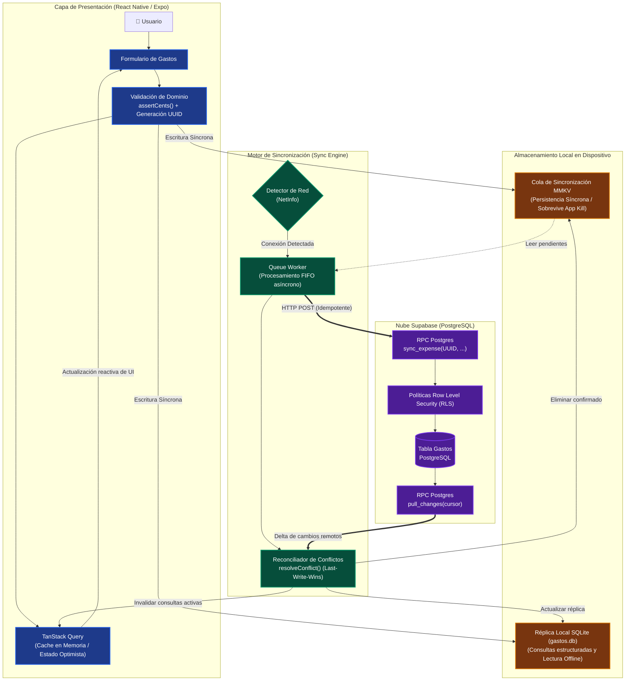
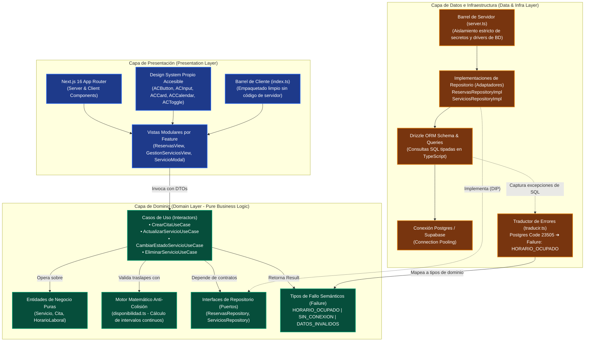
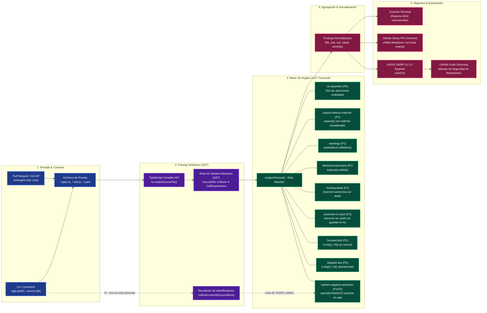
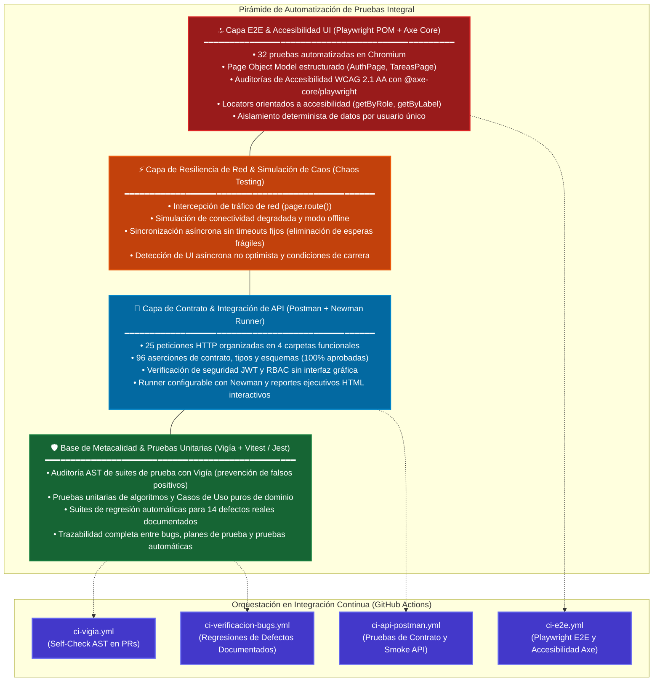

# Compendio de Arquitectura de Software y Estrategia de Calidad
### Portafolio Profesional — Eduardo Maytorena

[](./README.md)
[](https://www.typescriptlang.org/)
[](https://sarifweb.azurewebsites.net/)
[](https://www.w3.org/WAI/WCAG21/quickref/)

Este compendio documenta de forma visual, analítica y técnica las decisiones de diseño arquitectónico, patrones de software, protocolos de tolerancia a fallos y la estrategia de aseguramiento de calidad implementada en los proyectos insignia del portafolio.

Está diseñado para que **Líderes Técnicos, Arquitectos de Software, Staff Engineers y Reclutadores Técnicos** puedan auditar rápidamente la profundidad ingenieril, la madurez en diseño de sistemas y la prevención rigurosa de errores que rigen cada repositorio.

---

## 🗺️ Mapa Arquitectónico de Proyectos Insignia

| Proyecto | Dominio | Patrón Arquitectónico Principal | Invariante Crítico de Diseño | Mecanismo de Tolerancia a Fallos |
|---|---|---|---|---|
| **[Gastos (Control de Gastos)](../../gastos)** | Móvil (React Native / Expo) | **Offline-First Reactive Architecture** con cola síncrona en MMKV y réplica local SQLite | Aritmética monetaria exclusiva en centavos enteros (`assertCents`); generación de UUID en cliente para idempotencia | Cola FIFO en MMKV resistente a cierre forzado del SO; reconciliación simétrica con Last-Write-Wins (LWW) |
| **[Reservas (AgendaCitas)](../../reservas)** | Web SaaS (Next.js 16 / React 19) | **Clean Architecture** (Hexagonal/Onion) + **Feature-First** | Dominio puro libre de dependencias externas; Barrels cliente/servidor estrictamente segregados | Manejo semántico de errores mediante tipo `Failure`; motor matemático determinista de prevención de colisiones |
| **[Vigía](../../vigia)** | Developer Tooling / CI/CD Action | **Pipeline de Análisis Estático de Sintaxis (AST)** con TypeScript Compiler API | Inspección semántica de llamadas vs. regex frágil; validación cruzada de selectores negativos contra el código fuente | Formato OASIS SARIF v2.1.0 para GitHub Code Scanning; self-check en CI; modo `changed-only` para PRs veloces |
| **[Automatización E2E & QA](../../automatizacion-e2e)** | QA Core & Automation Framework | **Page Object Model (POM)** estructurado + Pirámide de Pruebas Multi-Capa | Locators por rol y etiqueta accesible (WCAG); cero esperas fijas; aislamiento total de datos por prueba | Captura determinista de trazas y capturas en fallos (`retain-on-failure`); suites de regresión acopladas a defectos reales |

---

## 1. Gastos · Arquitectura Offline-First y Sincronización Idempotente

### 1.1 Diagrama de Bloques y Almacenamiento Local
La aplicación móvil no considera la conectividad como un requisito, sino como una optimización progresiva. Los datos siempre se escriben primero en disco local antes de que la interfaz confirme la acción al usuario.



### 1.2 Diagrama de Secuencia del Flujo de Sincronización
Muestra el ciclo de vida de un gasto desde su creación en el cliente hasta su confirmación remota en PostgreSQL vía RPC.

```mermaid
sequenceDiagram
    autonumber
    actor User as Usuario (Móvil)
    participant UI as React Native UI<br/>(Expo / Reanimated)
    participant RQ as TanStack Query<br/>(Client Cache)
    participant LocalDB as SQLite Local DB<br/>(gastos.db / Read Replica)
    participant Queue as MMKV Sync Queue<br/>(Síncrono en Disco)
    participant Engine as Sync Engine<br/>(Worker & Reconcile)
    participant Net as Network Monitor<br/>(NetInfo)
    participant Supa as Supabase Cloud<br/>(PostgreSQL RPC)

    Note over User,UI: 1. Creación de Gasto (Completamente Offline u Online)
    User->>UI: Ingresa monto ($150.00) y categoría
    UI->>UI: assertCents(15000) & genera UUIDv4 en cliente
    UI->>RQ: Mutación optimista en cache local
    
    par Persistencia Síncrona en Disco (Aislamiento de fallo)
        UI->>LocalDB: INSERT INTO gastos (UUID, cents, local_date...)
        UI->>Queue: ENQUEUE payload {id, action: 'upsert', cents, version}
    end
    Note over UI,Queue: Si el SO cierra la app forzosamente, los datos persisten intactos
    UI-->>User: Feedback inmediato en UI (< 16ms / 60 FPS)

    Note over Engine,Supa: 2. Proceso de Sincronización en Segundo Plano
    Engine->>Net: Verifica estado de conexión
    alt Sin Conexión (Offline)
        Net-->>Engine: Offline
        Engine->>Engine: Pausa ejecución; cola permanece en MMKV
    else Con Conexión (Online)
        Net-->>Engine: Online
        Engine->>Queue: PEEK ítems pendientes
        Queue-->>Engine: Lista de operaciones pendientes
        
        Engine->>Supa: POST /rpc/sync_expense (payload con UUID del cliente)
        alt Éxito (HTTP 200)
            Supa-->>Engine: { success: true, server_version, updated_at }
            Engine->>Queue: DEQUEUE / REMOVE (ítem confirmado)
            Engine->>Engine: Reconciliación LWW (Last-Write-Wins)
            Engine->>RQ: Invalida y refresca consultas activas
        else Error de Red o Timeout
            Supa-->>Engine: Network Error / 5xx
            Engine->>Engine: Backoff exponencial; ítem permanece seguro en MMKV
        end

        opt Traer cambios remotos (Pull delta incremental)
            Engine->>Supa: POST /rpc/pull_changes (cursor)
            Supa-->>Engine: Delta de registros modificados
            Engine->>Engine: reconcile(local, remote) via resolveConflict()
            Engine->>LocalDB: Actualiza réplica SQLite local
            Engine->>RQ: Refresca consultas de UI
        end
    end
```

### 1.3 Decisiones de Ingeniería Destacadas
- **Aritmética en Centavos Enteros:** Elimina fallos de punto flotante IEEE-754 (`assertCents`).
- **Idempotencia por UUID en Cliente:** Reintentos de red o pulsaciones dobles colapsan en el mismo registro en la base de datos sin generar duplicados.
- **Fechas en Hora Local Explícita:** Se resuelven los límites mensuales según los componentes literales de la zona horaria del usuario, evitando desfasajes de UTC al cierre de mes.

---

## 2. Reservas (AgendaCitas) · Clean Architecture & Prevención de Colisiones

### 2.1 Diagrama de Capas de Clean Architecture + Feature-First
Alineado con los principios de Robert C. Martin, la regla de dependencia es estricta: **las dependencias apuntan exclusivamente hacia adentro, al Dominio**.



### 2.2 Patrón de Manejo de Errores con `Failure`
En lugar de propagar excepciones no controladas o códigos crudos de PostgreSQL (`23505`, `ECONNREFUSED`), la capa de datos captura las excepciones y las traduce al tipo de dominio `Failure`:

```
PostgreSQL / Drizzle Exception ➔ traducir(error) ➔ Failure.HORARIO_OCUPADO ➔ UI amigable con WCAG
```

Esto impide la fuga de detalles de infraestructura al usuario final y asegura que las vistas manejen estados de fallo tipados exhaustivamente (`exhaustive switch checking`).

---

## 3. Vigía · Pipeline de Análisis Estático de AST & GitHub Code Scanning

### 3.1 Diagrama del Pipeline de Procesamiento AST
Vigía inspecciona el Árbol de Sintaxis Abstracta de TypeScript para detectar pruebas que pasan en verde sin verificar aserciones o con falsos positivos.



### 3.2 Clasificación de Severidad y Compatibilidad de Frameworks
- **Severidad P1 (Bloqueante en CI):** Pruebas sin aserción, promesas sin `await`, tautologías literales, tests enfocados (`.only`).
- **Severidad P2 (Advertencia):** Selectores huérfanos con coincidencia parcial.
- **Severidad P3 (Informativa):** Tests omitidos (`.skip`) para alertar sobre pruebas ignoradas.
- **Frameworks Soportados:** Jest, Vitest, Playwright (matchers asíncronos), Cypress, Chai y flujos E2E de Maestro en YAML.

---

## 4. Automatización E2E & QA Core · Pirámide de Pruebas Multi-Capa

### 4.1 Diagrama de la Pirámide Integral de Testing
El ecosistema de calidad articula pruebas en cada nivel del ciclo de vida del software, desde el análisis estático y metacalidad hasta la auditoría de accesibilidad y simulación de caos en red.



### 4.2 Matriz de Estrategias y Cobertura de QA

| Estrategia / Nivel | Herramienta | Enfoque de Validación | Métrica Clave |
|---|---|---|---|
| **Metacalidad (AST)** | Vigía | Detección de pruebas vacías o falsos positivos antes del merge | 129 pruebas en 4 suites; 0 falsos positivos |
| **Pruebas de Dominio** | Vitest / Jest | Lógica de negocio pura, cálculo de disponibilidad y modelos monetarios | 98% cobertura en Gastos; 100% tipado estricto en Reservas |
| **Pruebas de Contrato API** | Postman + Newman | Contratos HTTP, seguridad JWT, validación de esquemas y tipos | 25 peticiones, 96 aserciones, 100% aprobadas |
| **Pruebas E2E (POM)** | Playwright | Flujos de usuario completos, persistencia y aislamiento entre cuentas | 32 pruebas automatizadas sin esperas fijas |
| **Accesibilidad (A11y)** | Axe Core + WCAG | Cumplimiento de WCAG 2.1 AA (contraste, teclado, ARIA, semántica) | 0 violaciones críticas de accesibilidad |
| **Pruebas de Regresión** | Suites Dedicadas | Validación automática de defectos previamente encontrados | 14 bugs de Gastos + 8 de QA blindados en CI |

---

## 5. Tabla Comparativa de Decisiones Técnicas y Trade-offs

| Decisión Arquitectónica | Alternativa Descartada | Justificación Técnica & Impacto |
|---|---|---|
| **MMKV síncrono para cola de sync** | `AsyncStorage` | `AsyncStorage` es asíncrono y los datos pendientes pueden perderse si el sistema operativo finaliza el proceso de la app antes de completar la escritura en disco. MMKV garantiza persistencia síncrona inmediata. |
| **UUID generado en el cliente** | `SERIAL` / Auto-increment en BD | Permite registrar entidades de forma offline instantánea y convierte cualquier reintento o doble clic en una operación naturalmente idempotente. |
| **Clean Architecture + Barrels separados** | Estructura tradicional por tipo de archivo (`controllers/`, `views/`) | Previene la fuga de dependencias pesadas de base de datos o secretos de Node.js al empaquetado del navegador en Next.js (`server.ts` vs `index.ts`). |
| **Análisis Estático por AST** | Expresiones regulares (Regex) | Los regex fallan catastróficamente ante cadenas de texto, comentarios multilínea o templates literales. El árbol AST de TypeScript proporciona conocimiento semántico real del código. |
| **Locators semánticos y accesibles** | Selectores XPath o clases CSS (`.btn-primary`) | Las clases CSS cambian con frecuencia ante rediseños estéticos. Los selectores por rol y etiqueta (`getByRole`, `getByLabel`) son resilientes y detectan regresiones de accesibilidad web. |

---

## 📂 Enlaces a Especificaciones Detalladas
- [Flujo Detallado Offline-First en Control de Gastos](./control-de-gastos-offline-first.md)
- [Especificación de Clean Architecture en Reservas](./reservas-clean-architecture.md)
- [Arquitectura del Pipeline AST de Vigía](./vigia-ast-pipeline.md)
- [Pirámide de Pruebas y Resiliencia en Automatización E2E](./automatizacion-e2e-testing-pyramid.md)
