# ADR-001: Generación Determinista de Valores Límite y Validación de Contratos sin Dependencias Externas

- **Estado:** Aceptado / Implementado en [`herramientas-qa`](../../herramientas-qa)
- **Fecha:** 2026-10-27
- **Autor:** Eduardo Maytorena (`eduardo_maytorenar@outlook.com`)
- **Ámbito:** Ingeniería de Calidad (QA Tooling), Pruebas de Contrato REST y Seguridad de Cadena de Suministro

---

## 1. Contexto y Planteamiento del Problema

Durante la evolución de las suites de aseguramiento de calidad del portafolio ([`pruebas-api-postman`](../../pruebas-api-postman), [`automatizacion-e2e`](../../automatizacion-e2e) y [`reporte-de-bugs`](../../reporte-de-bugs)), se identificaron tres riesgos recurrentes en plataformas de pruebas modernas:

1. **Irreproducibilidad por aleatoriedad no controlada (`Math.random()` / `Date.now()`):** Generar datos dinámicos evita colisiones de estado compartido, pero si un caso falla con una combinación particular de caracteres o longitudes en Integración Continua (CI), el ingeniero no puede reproducir exactamente el mismo payload en su máquina local sin una semilla determinista (*seed*).
2. **Deriva silenciosa de esquemas y tipos (`Schema Drift`):** Varios de los defectos reales documentados en producción/auditoría provinieron de violaciones sutiles de contrato o fronteras:
   - **`BUG-003` y `BUG-004`:** Ausencia de validación estricta en los bordes `[1, 200]` y aceptación de cadenas compuestas solo por espacios en blanco.
   - **`BUG-006`:** Serialización del campo `done` como entero (`0` / `1` proveniente de SQLite) en vez de `boolean` estricto en JSON.
   - **`BUG-007`:** Respuestas de colección sin sobre de paginación (`{ tasks, total, limit, offset }`) o aceptación de parámetros `limit` desbordados.
   - **Fuga accidental de columnas internas:** Si un endpoint serializa directamente una fila de base de datos sin DTO (`SELECT *`), puede exponer campos sensibles como `password_hash` sin romper aserciones laxas que solo verifican campos esperados.
3. **Superficie de ataque en dependencias de QA (`Supply Chain Risk`):** Instalar decenas de paquetes externos para generar fixtures o validar esquemas JSON pequeños introduce vulnerabilidades transitivas (CVEs), rompe pipelines por cambios menores de versión y ralentiza los tiempos de arranque en runners efímeros de GitHub Actions.

---

## 2. Decisión Arquitectónica

Se decide diseñar e incorporar el paquete interno **`@eduardomr1/herramientas-qa`** ([`herramientas-qa/`](../../herramientas-qa)) bajo tres invariantes de ingeniería:

1. **Cero dependencias externas en tiempo de ejecución y prueba (`Zero-Dependency Node.js 22`):** Uso exclusivo de módulos nativos auditados del runtime (`node:crypto`, `node:test`, `node:assert/strict`, `node:fs`, `node:child_process`).
2. **Generación determinista basada en semilla SHA-256 + Mulberry32 ([`generador-datos.js`](../../herramientas-qa/src/generador-datos.js)):**
   - Cualquier cadena de texto o identificador de build (`corrida-ci-4821`) se proyecta mediante `SHA-256` a un estado entero sin signo de 32 bits que alimenta un generador pseudoaleatorio `Mulberry32`.
   - Generación automatizada de tablas formales de **Análisis de Valores Límite (BVA)** y **Particiones de Equivalencia (EP)** según estándares ISTQB: `vacio`, `solo-espacios`, `min - 1`, `min`, `min + 1`, `nominal`, `max - 1`, `max`, `max + 1`, bordes con espacios y cadenas Unicode NFC.
3. **Validador declarativo de contratos JSON Schema + HTTP SLA ([`validador-contratos.js`](../../herramientas-qa/src/validador-contratos.js)):**
   - Tipado JSON estricto (`0` y `1` se clasifican como `integer`, jamás como `boolean`).
   - Bloqueo explícito de propiedades no documentadas (`additionalProperties: false`) para detectar fugas de atributos internos o deriva de contrato inmediatamente.
   - Validación combinada de código HTTP, cabecera `Content-Type: application/json`, vaciado estricto en `204 No Content` y presupuesto SLO de latencia (`maxLatenciaMs`).

---

## 3. Flujo de Verificación Determinista

```mermaid
flowchart LR
    Seed["Semilla de Corrida<br/>(ej. GITHUB_RUN_ID)"] --> Hash["Derivación SHA-256<br/>Estado 32-bit"]
    Hash --> PRNG["Motor Mulberry32<br/>(100% Reproducible)"]
    PRNG --> BVA["Generador BVA / EP<br/>min-1, min, max, max+1,<br/>blancos, Unicode NFC"]
    BVA --> Target["API / Función Bajo Prueba"]
    Target --> Resp["Respuesta HTTP / DTO<br/>{ status, headers, tiempoMs, cuerpo }"]
    Resp --> Validator["Validador de Contratos<br/>JSON Schema + SLO Latencia"]
    Validator -->|"Valido"| Pass["Compuerta CI Verde"]
    Validator -->|"Violacion"| Report["Reporte JSONPath Exacto<br/>ej. $.tasks[0].done"]

    classDef seed fill:#1e3a8a,stroke:#2563eb,stroke-width:2px,color:#fff;
    classDef engine fill:#4c1d95,stroke:#7c3aed,stroke-width:2px,color:#fff;
    classDef check fill:#064e3b,stroke:#059669,stroke-width:2px,color:#fff;

    class Seed,Hash seed;
    class PRNG,BVA,Target engine;
    class Resp,Validator,Pass,Report check;
```

---

## 4. Alternativas Evaluadas y Trade-offs

| Alternativa | Ventajas | Motivo de Descarte / Trade-off |
|---|---|---|
| **`@faker-js/faker` + `ajv`** | Ecosistema amplio y soporte completo de borradores JSON Schema complejos (`$ref` remotos, `unevaluatedProperties`). | Añade megabytes de dependencias innecesarias para contratos REST concisos y amplía la superficie de auditoría `npm audit`. Nuestro validador cubre el 100% de las reglas usadas en APIs REST con diagnóstico en español y rutas JSONPath claras. |
| **Aserciones imperativas manuales (`if (typeof x.done !== 'boolean')`)** | Sin abstracciones adicionales. | Código repetitivo, propenso a olvidar `additionalProperties: false` o validaciones en elementos anidados de arreglos paginados. |
| **Kit nativo `herramientas-qa` (Elegida)** | Arranque instantáneo (`< 250 ms`), 0 CVEs posibles por terceros, semillas reproducibles entre CI y entorno local, contratos congelados (`Object.freeze`). | No pretende reemplazar compiladores completos de OpenAPI v3.1 con referencias circulares externas; se enfoca en contratos HTTP/JSON de microservicios y automatización QA. |

---

## 5. Consecuencias e Impacto Medible

- **Reproducibilidad exacta:** Cualquier fallo detectado con una semilla específica se replica de forma idéntica pasando la misma semilla por CLI o test unitario.
- **Blindaje contra regresiones históricas:** Los defectos de clase `BUG-001`, `BUG-003`, `BUG-004`, `BUG-005`, `BUG-006` y `BUG-007` quedan modelados directamente como particiones BVA y contratos ejecutables.
- **Ejecución ultrarrápida en CI:** Al no requerir `npm install` para dependencias de terceros, la suite completa en `node --test` finaliza en fracciones de segundo en Node.js 22.
