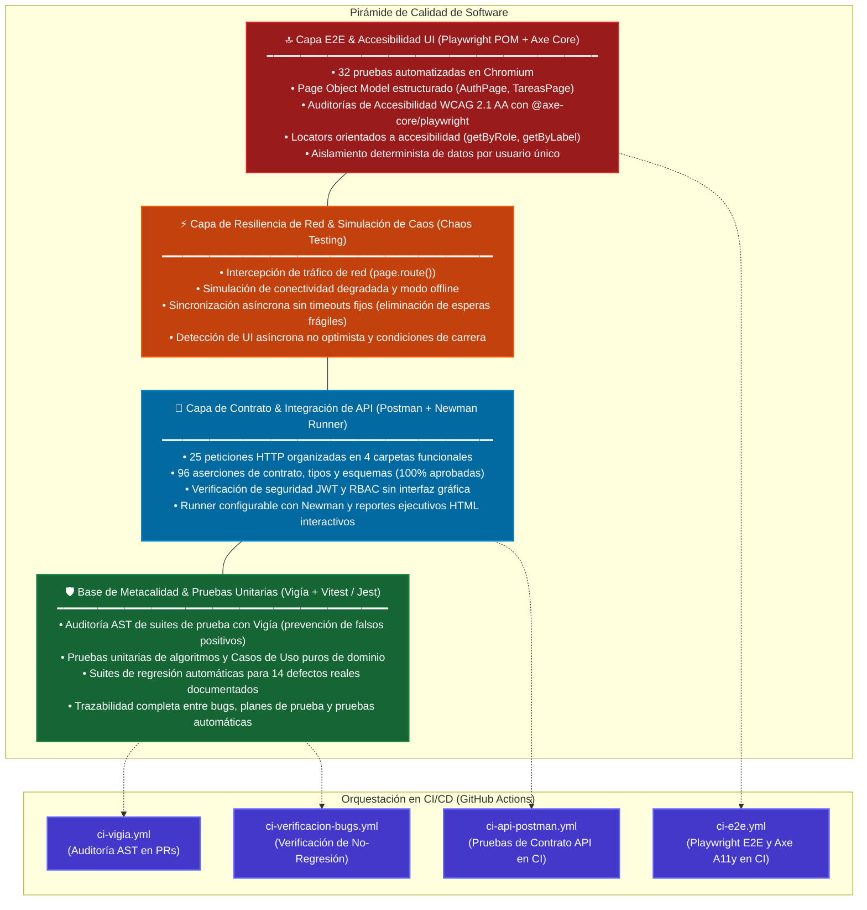

# Pirámide de Pruebas & Framework de Automatización E2E
### Caso de Estudio: Automatización Playwright, Accesibilidad Axe y Newman API

[](https://playwright.dev/)
[](https://github.com/dequelabs/axe-core-npm)
[](https://www.npmjs.com/package/newman)
[](../../.github/workflows)

Este documento expone la arquitectura del ecosistema de calidad y aseguramiento de software, implementando una **Pirámide de Pruebas Multi-Capa**, el patrón **Page Object Model (POM)** en Playwright, auditorías automatizadas de accesibilidad web (WCAG 2.1 AA) y pruebas de contrato de API REST con Newman.

---

## 1. La Filosofía de Aseguramiento de Calidad

El aseguramiento de calidad (QA) en este portafolio no es una fase tardía de validación manual, sino una disciplina de ingeniería continua gobernada por tres principios:

1. **Determinismo y Cero Flakiness:** Erradicación total de esperas basadas en tiempo (`page.waitForTimeout()`). Toda sincronización espera estados explícitos de la interfaz o de red (`toBeVisible()`, `waitFor()`).
2. **Locators Semánticos y Accesibles:** Prioridad absoluta a selectores basados en roles ARIA (`getByRole`) y etiquetas accesibles (`getByLabel`). Si la interfaz pierde accesibilidad, las pruebas fallan automáticamente.
3. **Aislamiento Absoluto de Datos:** Cada prueba genera dinámicamente credenciales y recursos únicos (`nuevoUsuario()`), permitiendo ejecuciones idempotentes sin necesidad de limpiar la base de datos entre casos.

---

## 2. Diagrama de la Pirámide de Automatización Integral



---

## 3. Patrón Page Object Model (POM) en Playwright

Para evitar la duplicación de selectores y permitir que las pruebas se redacten en términos de intenciones de negocio, la interacción con la aplicación se encapsula en Page Objects modulares:

```
automatizacion-e2e/
├── pages/
│   ├── AuthPage.js           # Encapsula selectores y acciones de Login / Registro
│   ├── TareasPage.js         # Encapsula selectores y acciones de la lista de tareas
│   └── index.js              # Barrel de exportación unificado
├── tests/
│   ├── accesibilidad.spec.js # Auditorías A11y con @axe-core/playwright (WCAG 2.1 AA)
│   ├── autenticacion.spec.js # Flujos de registro, login, credenciales inválidas
│   ├── tareas.spec.js        # CRUD completo de tareas y aislamiento de usuarios
│   ├── regresiones-ui.spec.js# Verificación de corrección de bugs documentados
│   └── fixtures/
│       └── a11y.js           # Fixture reutilizable inyectando AxeBuilder configurado
```

### Ejemplo de Prueba Orientada a Intención
```javascript
test('crea una tarea y verifica el contador reactivo', async () => {
  await tareasPage.agregarTarea('Escribir el plan de pruebas');
  await expect(tareasPage.obtenerTarea('Escribir el plan de pruebas')).toBeVisible();
  await tareasPage.esperarContador('1 pendiente');
});
```

---

## 4. Auditorías Automatizadas de Accesibilidad (WCAG 2.1 AA)

Mediante `@axe-core/playwright`, cada pantalla clave se audita automáticamente contra las directrices de accesibilidad web:

```javascript
const resultados = await new AxeBuilder({ page })
  .withTags(['wcag2a', 'wcag2aa', 'wcag21a', 'wcag21aa'])
  .analyze();

expect(resultados.violations).toEqual([]);
```

### Criterios Validados Automáticamente:
- **WCAG 1.4.3 (Contraste Mínimo):** Relación de contraste $\ge 4.5:1$ en texto normal y $\ge 3:1$ en componentes gráficos y estados de foco.
- **WCAG 1.3.1 & 4.1.2 (Estructura Semántica y Roles ARIA):** Presencia de regiones `main`, títulos jerárquicos `h1`, mensajes de error con `role="alert"` y atributos `aria-label` en controles interactivos.
- **WCAG 2.1.1 (Navegación por Teclado):** Operabilidad 100% mediante teclado con indicadores de foco visibles (`outline`).

---

## 5. Pruebas de Contrato de API y Simulación de Caos en Red

### 5.1 Automatización con Newman
La suite de pruebas de API (`pruebas-api-postman`) ejecuta 25 peticiones HTTP y 96 aserciones que validan:
- Códigos de estado HTTP y encabezados `Content-Type`.
- Contratos de payload JSON mediante validación estricta de esquemas.
- Autenticación con JWT, vencimiento de tokens y aislamiento multi-tenant.
- Reportes ejecutivos interactivos generados con `newman-reporter-htmlextra`.

### 5.2 Simulación de Red y Caos (Network Chaos)
Mediante `page.route()` de Playwright, se simulan condiciones adversas de red:
- **Latencia Artificial (Throttling):** Validación de que la UI mantenga estados de carga visuales y no bloquee el hilo principal.
- **Modo Offline & Abort:** Demostración de que la aplicación maneja fallos de red con mensajes claros y no queda en estado bloqueado.
- **Manejo de Respuestas Lentas:** Detección de que el checkbox de tareas en la aplicación bajo prueba es asíncrono y requiere confirmación de la API antes de cambiar de estado en pantalla.
