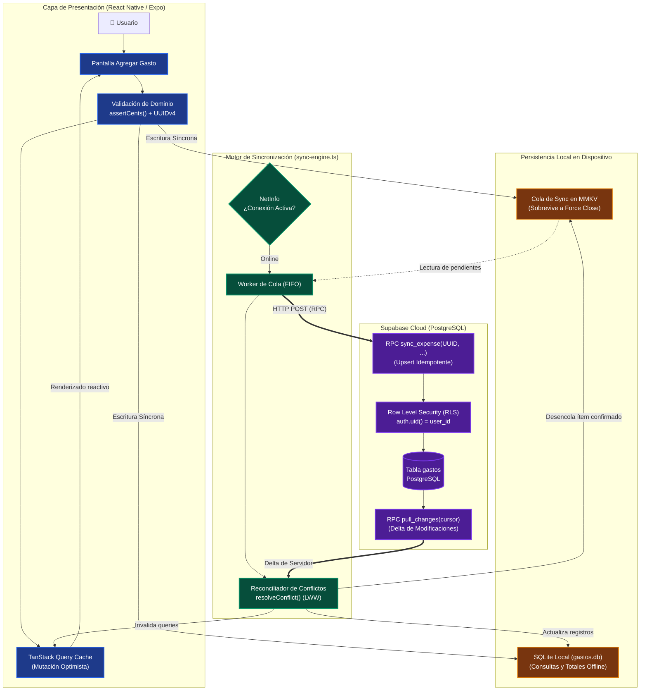
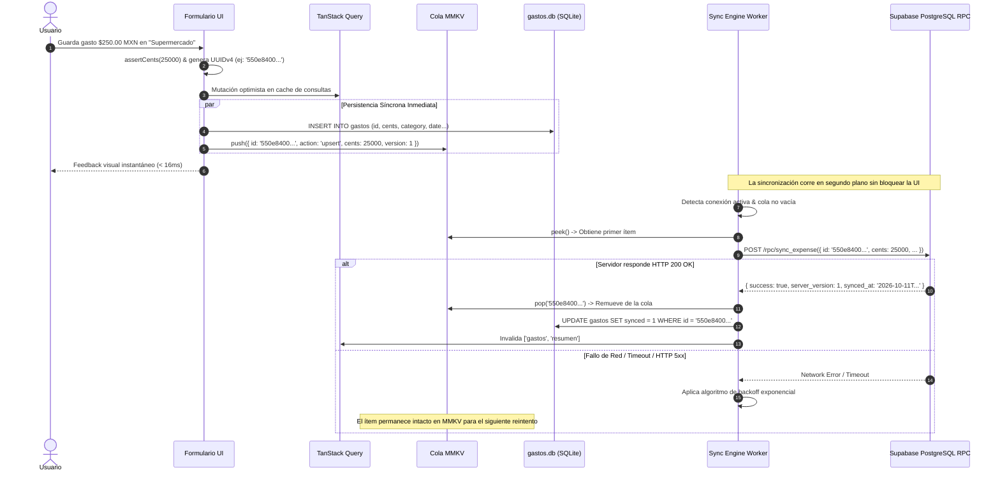

# Arquitectura Offline-First & Sincronización Idempotente
### Caso de Estudio: Aplicación Móvil Control de Gastos

Este documento detalla los principios de diseño, la topología de almacenamiento local, el ciclo de vida de las mutaciones optimistas y el protocolo de resolución de conflictos implementado en la aplicación de control de gastos personales.

---

## 1. Principio Rector: Offline como Ciudadano de Primera Clase

La gran mayoría de las aplicaciones móviles tratan el modo offline como una condición excepcional o de error. En **Control de Gastos**, el diseño invierte esa premisa:

1. **La UI nunca espera a la red:** Toda operación de guardado, actualización o borrado impacta de manera inmediata (< 16ms) en la interfaz del usuario.
2. **Escritura síncrona en dos subsistemas desacoplados:**
   - **Copia Local (SQLite - `gastos.db`):** Sirve como la réplica de lectura offline estructurada. Las consultas SQL y filtros de UI se ejecutan contra esta base de datos local.
   - **Cola de Sincronización (MMKV - `syncQueue`):** Almacena las operaciones pendientes por enviar al servidor en orden FIFO. Se implementa en MMKV debido a que las escrituras son síncronas en disco y no dependen del event loop asíncrono de React Native, asegurando que un cierre repentino de la aplicación por el sistema operativo nunca pierda un gasto registrado.

---

## 2. Diagrama de Arquitectura de Almacenamiento y Sincronización

---

## 3. Protocolo de Sincronización Idempotente

### 3.1 Identificadores en el Cliente (UUIDv4)
En lugar de depender de claves auto-incrementales del servidor, el identificador único del gasto se genera en el cliente al momento de crearlo. Esto aporta tres beneficios arquitectónicos fundamentales:
- **Idempotencia ante fallos de red:** Si la petición HTTP viaja al servidor, se procesa, pero la respuesta de confirmación se pierde por un corte de red, el reintento posterior del cliente envía exactamente el mismo UUID. El RPC de Postgres ejecuta un `ON CONFLICT (id) DO UPDATE`, evitando duplicidades.
- **Inmunidad a doble tap:** Pulsaciones múltiples o accidentales sobre el botón de guardar generan una sola entidad en la base de datos.
- **Relaciones locales inmediatas:** Si en el futuro se asociaran recibos fotográficos o etiquetas al gasto, las relaciones pueden establecerse de forma local y offline con el UUID antes de tocar la red.

### 3.2 Diagrama de Secuencia Detallado

---

## 4. Resolución de Conflictos y Simetría Cliente-Servidor

Cuando un registro es modificado en dos dispositivos distintos sin conexión previa, la convergencia se resuelve mediante una estrategia determinista de **Last-Write-Wins (LWW)** basada en marcas temporales ISO y números de versión monótonos crecientes:

- La función `resolveConflict(local, remote)` implementa exactamente la misma regla en el cliente TypeScript (`src/shared/lib/sync-engine.ts`) que la función PL/pgSQL en el servidor (`sync_expense`).
- **Simetría garantizada:** Sin importar el orden en que los paquetes de sincronización alcancen los dispositivos, el resultado final convergente es matemática y lógicamente idéntico.

---

## 5. Prevención de Pérdida de Datos en Cierre de Sesión

Un riesgo común en arquitecturas offline-first es la filtración de datos entre diferentes cuentas de usuario en un mismo dispositivo compartido (descubierto y documentado como **BUG-013** en el proyecto):

1. **Intento de Flush previo:** Al solicitar logout, el motor intenta vaciar la cola pendiente en el servidor.
2. **Purgado de Réplica Local:** Se truncan las tablas locales en SQLite y se eliminan las colas de MMKV asociadas al usuario saliente.
3. **Invalidación de Token:** Finalmente, se revoca la sesión en Supabase Auth.
4. **Resultado:** Ningún dato del usuario previo queda expuesto para la siguiente sesión que inicie en el dispositivo.
