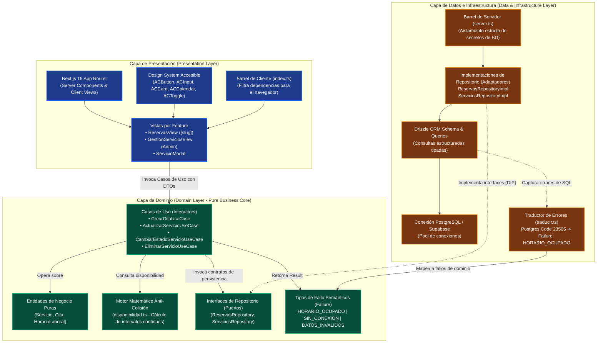

# Clean Architecture & Feature-First en Aplicaciones SaaS
### Caso de Estudio: Plataforma de Reservas y Agenda (AgendaCitas)

[](../../reservas)
[](https://nextjs.org/)
[](https://orm.drizzle.team/)
[-3178C6)](https://www.typescriptlang.org/)

Este documento describe la arquitectura modular basada en **Clean Architecture (Onion / Ports & Adapters)** y organización vertical **Feature-First** implementada en el sistema de gestión de citas en tiempo real.

---

## 1. Principios Arquitectónicos Fundamentales

1. **Independencia del Framework:** La lógica de negocio fundamental (cálculo de solapamiento de citas, reglas de disponibilidad laboral, validaciones de catálogo de servicios) vive en clases y funciones puras de TypeScript, completamente aisladas de React o Next.js.
2. **Inversión de Dependencias (DIP):** Los Casos de Uso del dominio nunca dependen directamente de bibliotecas de base de datos o llamadas de red. Dependen de interfaces abstractas (*Puertos*). La capa de infraestructura implementa dichas interfaces (*Adaptadores*).
3. **Aislamiento Seguro entre Runtime de Cliente y Servidor:**
   - **`index.ts` (Client Barrel):** Exporta exclusivamente componentes de React, hooks y tipos de interfaz seguros para empaquetado en el navegador.
   - **`server.ts` (Server Barrel):** Exporta implementaciones de repositorios Drizzle, clientes directos de base de datos y Server Actions. Garantiza que ninguna credencial ni paquete nativo de Node.js sea referenciado en el bundle cliente.

---

## 2. Diagrama de Capas y Flujo de Dependencias



---

## 3. El Motor Matemático de Disponibilidad Anti-Colisión

En un SaaS de citas, el mayor riesgo operacional son las colisiones de agenda (dos citas solapadas en el mismo horario o citas fuera del rango laboral).

El motor matemático en `src/lib/disponibilidad.ts` implementa un algoritmo determinista:

1. **Conversión a Minutos Absolutos:** Todo horario (`09:30`, `14:45`) se convierte a minutos enteros desde la medianoche (`570`, `885`), eliminando dependencias de librerías de fechas pesadas y posibles desajustes por zonas horarias.
2. **Generación de Slots:** Dado el rango laboral $[T_{\text{inicio}}, T_{\text{fin}}]$ y la duración del servicio $D$, calcula los candidatos válidos $S_k = T_{\text{inicio}} + k \cdot \Delta$.
3. **Cruce Anti-Colisión:** Para cada candidato $[S_k, S_k + D]$, verifica que para toda cita existente $[C_i, C_i + D_i]$, se cumpla:
   $$\max(S_k, C_i) \ge \min(S_k + D, C_i + D_i)$$
   Si no se solapan y el horario no está en el pasado ni fuera de rango laboral, el slot se marca disponible.

---

## 4. Patrón `Failure` y Tipado Seguro de Errores

En lugar de utilizar bloques `try/catch` genéricos que devuelven errores anónimos (`unknown` o `any`), el sistema modela los fallos de negocio como valores tipados de primera clase:

```typescript
export type FailureType =
  | 'HORARIO_OCUPADO'
  | 'NEGOCIO_CERRADO'
  | 'DATOS_INVALIDOS'
  | 'NO_ENCONTRADO'
  | 'SIN_CONEXION'
  | 'ERROR_INTERNO';

export interface Failure {
  readonly tipo: FailureType;
  readonly mensaje: string;
  readonly detalle?: unknown;
}
```

### Ventajas Técnicas:
- **Exhaustividad en Compilador:** Las vistas de React evalúan el tipo de fallo mediante `switch (resultado.error.tipo)` con verificación exhaustiva de TypeScript. Si se agrega un nuevo tipo de fallo, el compilador alerta de inmediato las vistas que no lo han manejado.
- **Seguridad en Producción:** Previene que cadenas de conexión, nombres de columnas o códigos internos de PostgreSQL lleguen al navegador o a logs públicos.
