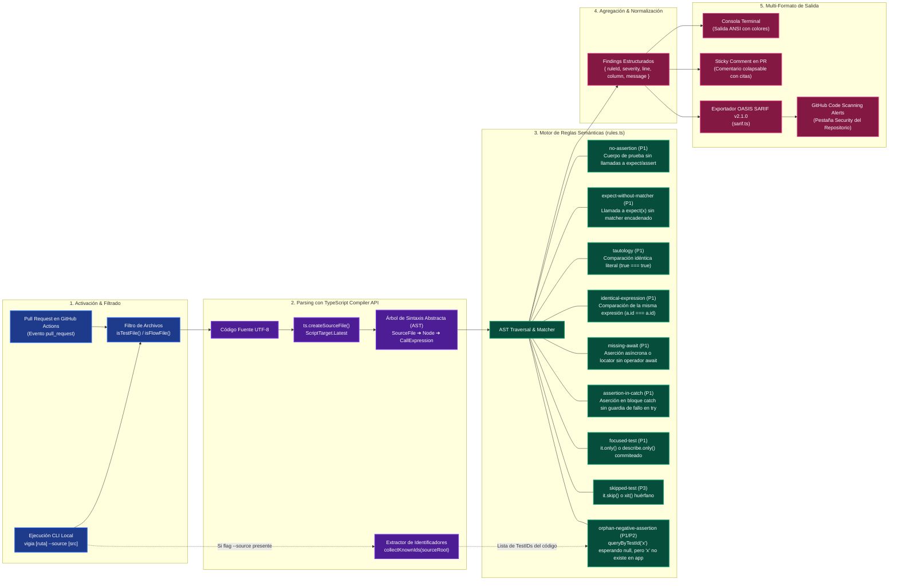

# Pipeline de Análisis Estático de AST & OASIS SARIF
### Caso de Estudio: Vigía (Linter AST & GitHub Action para Suites de Pruebas)

[](../../vigia)
[](https://sarifweb.azurewebsites.net/)
[](https://docs.github.com/en/code-security/code-scanning)
[-brightgreen)](../../vigia)

Este documento detalla el diseño interno del analizador estático de código **Vigía**, concebido para inspeccionar archivos de prueba automatizada y erradicar falsos positivos, tests sin aserciones reales y aserciones negativas huérfanas mediante la **API del Compilador de TypeScript**.

---

## 1. El Problema Técnico: La Falsa Confianza de una Suite en Verde

Las herramientas de cobertura de código tradicionales (como Estambul, c8 o nyc) operan a nivel de **ejecución de líneas**. Si una función de prueba ejecuta código de producción pero olvida invocar `expect()`, la línea de producción se marca como "cubierta" al 100%, a pesar de que el test jamás podrá fallar ante un defecto real:

```typescript
// ❌ Pasa en verde siempre, reporta 100% cobertura, pero nunca verifica nada
it('procesa el pago del usuario', async () => {
  const resultado = await procesarPago(datos);
  // Se omitió la aserción...
});
```

Los linters basados en expresiones regulares (regex) fallan en este contexto porque no pueden distinguir entre una llamada real a `expect()`, una mención en un comentario `// expect(x)` o una ocurrencia dentro de una cadena de texto.

---

## 2. Diagrama de Flujo del Pipeline AST de Vigía



---

## 3. Desglose de Reglas de Detección

| Identificador de Regla | Severidad | Nivel SARIF | Descripción del Patrón Detectado |
|---|---|---|---|
| `no-assertion` | **P1** | `error` | Bloque `it()`, `test()` o equivalente que no contiene llamadas a matchers de aserción. |
| `expect-without-matcher` | **P1** | `error` | Llamada a `expect(resultado)` huérfana, sin encadenar `.toBe()`, `.toEqual()`, etc. |
| `tautology` | **P1** | `error` | Comparación de literales idénticos como `expect(true).toBe(true)`. |
| `identical-expression` | **P1** | `error` | Comparación donde el sujeto y el argumento esperado son la misma expresión sintáctica (ej. `expect(u.id).toBe(u.id)`). |
| `missing-await` | **P1** | `error` | Invocación de aserciones asíncronas de Playwright (`await expect(locator).toBeVisible()`) o `.rejects` de Jest sin `await`. La prueba finaliza antes de evaluar la promesa. |
| `assertion-in-catch` | **P1** | `error` | Bloque `try { op(); } catch (e) { expect(e)... }` sin un `expect.unreachable()` o `fail()` en el bloque `try`. Si la operación no lanza excepción, el test pasa silenciosamente. |
| `focused-test` | **P1** | `error` | Presencia de `.only` o `fit()`, lo cual provoca que CI omita silenciosamente el resto de la suite de pruebas. |
| `skipped-test` | **P3** | `note` | Pruebas marcadas como `.skip` o `xit()`, previniendo que tests ignorados queden en el olvido. |
| `orphan-negative-assertion` | **P1 / P2** | `error` / `warning` | Aserción que espera ausencia de un elemento (`queryByTestId('modal-alerta')` igual a null), pero el identificador `'modal-alerta'` jamás existe en el código fuente de la app. |

---

## 4. Detección de Aserciones Negativas Huérfanas

Una de las contribuciones más innovadoras de Vigía es la regla **Orphan Negative Assertion**:

1. **Recolección (`collectKnownIds`):** Cuando se ejecuta con `--source src`, Vigía recorre el código fuente de la aplicación cosechando todos los valores de `data-testid`, `accessibilityLabel`, IDs y constantes semánticas.
2. **Cruce Semántico:** En los archivos de prueba, cuando detecta aserciones como `expect(screen.queryByTestId('banner-promo')).toBeNull()`, verifica si `'banner-promo'` figura en el índice de IDs válidos de la app.
3. **Detección de Error Tipográfico:** Si el ID no existe en la app, la prueba pasaba no porque validara la desaparición correcta del banner, sino porque un error tipográfico en la prueba hacía imposible que encontrara el elemento.

---

## 5. Integración Nativa con OASIS SARIF v2.1.0

Vigía exporta sus hallazgos en formato estándar **Static Analysis Results Interchange Format (SARIF)**:
- Permite la ingesta nativa en **GitHub Code Scanning**.
- Los defectos detectados aparecen inline en la pestaña de Seguridad del repositorio y bloquean el Pull Request según las políticas de branch protection rules.
- Compatible con visores SARIF de VS Code, Azure DevOps y GitLab.
