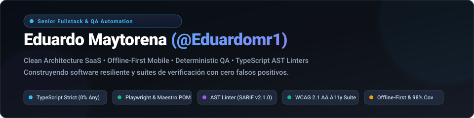

<div align="center">

<picture>
  <source media="(prefers-color-scheme: dark)" srcset="./assets/header-dark.svg">
  <source media="(prefers-color-scheme: light)" srcset="./assets/header-light.svg">
  
</picture>

<br/>

[](https://github.com/Eduardomr1)
[](mailto:eduardo_maytorenar@outlook.com)
[-0ea5e9?style=for-the-badge&logo=googlemaps&logoColor=white)](https://maps.google.com)
[](mailto:eduardo_maytorenar@outlook.com)

<br/>

[-3178C6?logo=typescript&logoColor=white)](https://www.typescriptlang.org/)
[](https://github.com/Eduardomr1/proyectos-de-qa/tree/main/docs/arquitectura)
[](https://github.com/Eduardomr1/proyectos-de-qa/blob/main/plan-de-pruebas/matriz-trazabilidad-automatizacion.md)
[](https://www.w3.org/WAI/WCAG21/quickref/)
[](https://github.com/Eduardomr1/vigia)

</div>

---

## 👨‍💻 Perfil Profesional

Ingeniero de Software **Senior Fullstack & QA Automation** especializado en la concepción y construcción de sistemas de alta confiabilidad, aplicaciones móviles **Offline-First**, arquitecturas desacopladas (**Clean Architecture**) y suites de automatización deterministas (**Playwright**, **Maestro**, **Newman**).

Mi filosofía de ingeniería se fundamenta en un principio rector: **la calidad y la estabilidad no son fases tardías ni tareas reactivas, sino invariantes arquitectónicas** que deben blindarse mediante tipado estricto, análisis estático de sintaxis abstracta (**AST**), pruebas de contrato, auditorías automatizadas de accesibilidad (**WCAG 2.1 AA**) y pipelines de integración continua deterministas (**CI/CD con 0% pruebas intermitentes**).

### 💡 Principales Capacidades de Ingeniería

- 🏛️ **Arquitectura de Software & SaaS:** Diseño bajo *Clean Architecture* (Hexagonal / DDD) y *Feature-First*. Aislamiento riguroso del dominio de negocio, motores anti-colisión deterministas y manejo semántico de errores mediante tipos de fallo (`Failure`).
- 📱 **Ingeniería Móvil Offline-First:** Desarrollo reactivo en *React Native & Reanimated* con colas de persistencia síncrona en *MMKV* (resilientes a cierre forzado del SO), reconciliación simétrica e idempotencia por UUID en cliente.
- 🧪 **Automatización QA & Chaos Resilience:** Frameworks E2E con *Page Object Model (POM)* en *Playwright*, auditorías de accesibilidad con `@axe-core/playwright`, simulación de resiliencia de red (HTTP 500/404, offline, slow 3G) y ejecución de contratos de API en *Newman/Postman*.
- 🔍 **Developer Tooling & Análisis Estático (AST):** Creación de linters sobre el *TypeScript Compiler API* capaces de inspeccionar el AST para erradicar falsos positivos en suites de prueba y exportar reportes en el estándar de seguridad *OASIS SARIF v2.1.0*.
- 📡 **Observabilidad & Uptime Engines:** Monitoreo sintético distribuido de APIs, cálculo de percentiles de latencia (P50/P90/P99), jitter, detección temprana de degradación de SLAs y despacho de webhooks con control de flapping.

---

## 🚀 Showcase de Proyectos Estrella

Una muestra representativa de sistemas diseñados para producción, con estándares rigurosos de código, documentación técnica profunda y cobertura de pruebas automatizada:

<br/>

### 1. 📱 [Control de Gastos](https://github.com/Eduardomr1/control-de-gastos) · Mobile Engineering & Offline-First
> **Aplicación financiera móvil de alta precisión con sincronización síncrona offline y microinteracciones fluidas a 60 FPS.**

[](https://reactnative.dev/)
[](https://expo.dev/)
[](https://docs.swmansion.com/react-native-reanimated/)
[](https://github.com/mrousavy/react-native-mmkv)
[](https://supabase.com/)
[-059669)](https://github.com/Eduardomr1/control-de-gastos)
[](https://maestro.mobile.dev/)

* **Arquitectura de Sincronización:** Cola FIFO de mutaciones en memoria y disco (*MMKV*) que sobrevive al cierre forzado de la app. Reconciliación con réplica local *SQLite* y PostgreSQL remoto mediante RPC idempotente (`sync_expense`).
* **Aritmética Financiera Exacta:** Todos los cálculos monetarios operan exclusivamente sobre **centavos enteros** (`assertCents`), erradicando las aberraciones de redondeo de coma flotante IEEE-754.
* **Idempotencia Nativa:** Los identificadores UUIDv4 son generados en el dispositivo; los reintentos de red y dobles pulsaciones colapsan naturalmente en la misma entidad sin registros duplicados.
* **Accesibilidad & UX:** Soporta escalado dinámico de tipografía de hasta 310% sin rupturas visuales y animaciones físicas con *React Native Reanimated*.

🔗 **Recursos:** [Repositorio en GitHub](https://github.com/Eduardomr1/control-de-gastos) · [Especificación de Arquitectura Offline-First](https://github.com/Eduardomr1/proyectos-de-qa/blob/main/docs/arquitectura/control-de-gastos-offline-first.md)

---

### 2. 📅 [AgendaCitas / Reservas](https://github.com/Eduardomr1/agendacitas) · Clean Architecture SaaS
> **Plataforma SaaS multitenant para gestión y reserva de turnos en tiempo real con motor matemático anti-colisión.**

[-000000?logo=next.js&logoColor=white)](https://nextjs.org/)
[](https://vuejs.org/)
[](https://www.typescriptlang.org/)
[](https://tailwindcss.com/)
[](https://orm.drizzle.team/)
[](https://vitest.dev/)
[](#)

* **Clean Architecture + Feature-First:** Separación formal de tres capas: `Domain` (entidades y casos de uso puros sin dependencias externas), `Data` (repositorios Drizzle / Supabase) y `Presentation` (componentes UI).
* **Segregación de Barrels Cliente/Servidor:** Barrels diferenciados (`index.ts` vs `server.ts`) que imposibilitan físicamente la fuga de módulos de Node.js o secretos del servidor hacia los bundles del cliente.
* **Motor Anti-Colisión Determinista:** Algoritmo matemático para validación de ventanas laborales y solapamientos concurrentes, respaldado por tipos de error de dominio semánticos (`Failure`).
* **Design System Accesible:** Componentes interactivos (`ACButton`, `ACInput`, `ACCard`) con objetivos táctiles conformes a estándares WCAG ($\ge 44$px) y contraste AA.

🔗 **Recursos:** [Repositorio en GitHub](https://github.com/Eduardomr1/agendacitas) · [Especificación de Clean Architecture](https://github.com/Eduardomr1/proyectos-de-qa/blob/main/docs/arquitectura/reservas-clean-architecture.md)

---

### 3. 🛡️ [Vigía](https://github.com/Eduardomr1/vigia) · TypeScript AST Linter & GitHub Action
> **Herramienta de análisis estático basada en AST que audita suites de pruebas para erradicar falsos positivos y aserciones huérfanas.**

[](https://github.com/microsoft/TypeScript/wiki/Using-the-Compiler-API)
[](https://nodejs.org/)
[](https://github.com/Eduardomr1/vigia)
[](https://sarifweb.azurewebsites.net/)
[](#)
[-059669)](https://github.com/Eduardomr1/vigia)

* **Inspección de Sintaxis Semántica:** A diferencia de linters basados en expresiones regulares que fallan ante saltos de línea o strings, Vigía navega el árbol AST identificando llamadas reales de frameworks de test.
* **Detección de 8 Reglas Críticas (P1–P3):** Identifica pruebas vacías sin aserciones, llamadas a `expect()` huérfanas sin matcher encadenado, promesas asíncronas sin `await`, aserciones en bloques `catch` silenciosos y tautologías literales (`expect(true).toBe(true)`).
* **Detector de Aserciones Huérfanas:** Cruza selectores negativos (`queryByTestId('id')`) con los identificadores presentes en el código de producción; si el id no existe en la app, alerta que la prueba pasaba por error tipográfico y no por validación genuina.
* **Integración Nativa con GitHub Code Scanning:** Emite reportes *OASIS SARIF v2.1.0* con anotaciones automáticas en el diff de Pull Requests y análisis diferencial veloz (`changed-only`).

🔗 **Recursos:** [Repositorio en GitHub](https://github.com/Eduardomr1/vigia) · [Especificación del Pipeline AST & SARIF](https://github.com/Eduardomr1/proyectos-de-qa/blob/main/docs/arquitectura/vigia-ast-pipeline.md)

---

### 4. 🎭 [Automatización E2E & QA Core](https://github.com/Eduardomr1/proyectos-de-qa) · Playwright POM & A11y WCAG 2.1 AA
> **Framework de automatización E2E, auditorías de accesibilidad web Axe-Core y suite de contratos de API en CI con cero pruebas intermitentes.**

[](https://playwright.dev/)
[](https://www.deque.com/axe/)
[](https://www.postman.com/)
[](#)
[-10b981)](#)
[](#)

* **Page Object Model Estructurado:** Aislamiento absoluto de selectores y acciones de usuario en clases `AuthPage` y `TareasPage`, manteniendo las aserciones puras en los archivos de especificación.
* **Locators Basados en Accesibilidad & Resiliencia:** Priorización estricta de selectores semánticos (`getByRole`, `getByLabel`), garantizando inmunidad ante cambios cosméticos de CSS.
* **Auditorías de Accesibilidad Integradas:** Pruebas automatizadas con `@axe-core/playwright` que evalúan contraste de color, estructura ARIA de hitos (`banner`, `main`), formularios accesibles y navegación por teclado.
* **Simulación de Resiliencia ante Caos de Red:** Pruebas E2E especializadas con mocking de fallos de servidor (HTTP 500, 404), modo sin conexión (*offline*) y simulación de conectividad degradada (*Slow 3G*).
* **Contratos de API & Matriz RTM:** Suite de 25 peticiones y 96 aserciones en *Newman* con reportes ejecutivos *htmlextra*, respaldada por una Matriz de Trazabilidad de Requisitos (RTM) completa.

🔗 **Recursos:** [Repositorio en GitHub](https://github.com/Eduardomr1/proyectos-de-qa) · [Pirámide de Pruebas](https://github.com/Eduardomr1/proyectos-de-qa/blob/main/docs/arquitectura/automatizacion-e2e-testing-pyramid.md) · [Matriz de Trazabilidad RTM](https://github.com/Eduardomr1/proyectos-de-qa/blob/main/plan-de-pruebas/matriz-trazabilidad-automatizacion.md) · [Auditoría de Dependencias](https://github.com/Eduardomr1/proyectos-de-qa/blob/main/reporte-de-bugs/auditoria-seguridad-dependencias.md)

---

### 5. ⚡ [PulseTrack](https://github.com/Eduardomr1/pulsetrack) · API Observability & Uptime Engine
> **Motor de monitoreo sintético distribuido para observabilidad de APIs en tiempo real, cálculo de SLA/SLO y telemetría de latencia.**

[](https://www.typescriptlang.org/)
[](https://fastify.dev/)
[](https://redis.io/)
[](https://www.docker.com/)
[](https://opentelemetry.io/)
[](#)

* **Sondeo Sintético Distribuido:** Motor de ejecución no bloqueante que evalúa continuamente endpoints REST, GraphQL y WebSockets con resolución submilisegundo.
* **Telemetría de Latencia (P50 / P90 / P99):** Agregación estadística de tiempos de respuesta, cálculo de jitter e identificación inmediata de anomalías de red o saturación de base de datos.
* **Validación Profunda de Contratos HTTP:** Aserción en tiempo real de esquemas de respuesta (*JSON Schema*), cabeceras de seguridad, límites presupuestarios de tiempo de respuesta y caducidad de certificados TLS/SSL.
* **Despachador Inteligente de Webhooks:** Notificaciones multicanal con control de flapping (histeresis) y ventanas de enfriamiento para prevenir fatiga de alertas en incidentes transitorios.

🔗 **Recursos:** [Repositorio en GitHub](https://github.com/Eduardomr1/pulsetrack) · [Arquitectura de Observabilidad](https://github.com/Eduardomr1/proyectos-de-qa/tree/main/docs/arquitectura)

---

## 🛠️ Stack Tecnológico & Arsenal de Ingeniería

<table width="100%">
  <thead>
    <tr>
      <th width="28%">Categoría</th>
      <th width="42%">Tecnologías & Herramientas</th>
      <th width="30%">Enfoque & Estándares</th>
    </tr>
  </thead>
  <tbody>
    <tr>
      <td><b>Lenguajes & Runtimes</b></td>
      <td>
        
        
        
        
        
      </td>
      <td>TypeScript modo <code>strict</code>, 0% <code>any</code>, <code>exactOptionalPropertyTypes</code>, ES Modules nativos.</td>
    </tr>
    <tr>
      <td><b>Frontend & Móvil</b></td>
      <td>
        
        
        
        
        
        
        
      </td>
      <td>Component-driven design, animación física 60 FPS, Server Actions, accesibilidad táctil $\ge 44$px.</td>
    </tr>
    <tr>
      <td><b>Backend, Datos & Cache</b></td>
      <td>
        
        
        
        
        
        
        
        
      </td>
      <td>Arquitectura Offline-First, colas síncronas en disco, RPCs idempotentes, RLS y esquemas declarativos.</td>
    </tr>
    <tr>
      <td><b>QA Automation & Testing</b></td>
      <td>
        
        
        
        
        
        
        
      </td>
      <td>Page Object Model (POM), auditorías WCAG 2.1 AA, suites de resiliencia de red, 0% flakiness en CI.</td>
    </tr>
    <tr>
      <td><b>Tooling, AST & DevOps</b></td>
      <td>
        
        
        
        
        
        
      </td>
      <td>Análisis estático de sintaxis (AST), seguridad en Code Scanning, pipelines paralelos y compilación multi-etapa.</td>
    </tr>
  </tbody>
</table>

---

## 🏛️ Compendio de Arquitectura de Sistemas & Diagramas Mermaid

Para una auditoría técnica profunda, he documentado formalmente los diagramas de secuencia, mapas de componentes y flujos de datos de cada solución en **[`docs/arquitectura/`](https://github.com/Eduardomr1/proyectos-de-qa/tree/main/docs/arquitectura)**:

```
docs/arquitectura/
├── README.md                              # Compendio ejecutivo y mapa arquitectónico global
├── control-de-gastos-offline-first.md     # Flujo síncrono MMKV, réplica SQLite y RPC idempotente
├── reservas-clean-architecture.md         # Aislamiento de dominio, anti-colisión y barrels cliente/servidor
├── vigia-ast-pipeline.md                  # AST Compiler API, reglas de detección y SARIF v2.1.0
└── automatizacion-e2e-testing-pyramid.md  # POM Playwright, auditorías Axe-Core y contratos Newman
```

* **[📐 Ver el Compendio Completo de Arquitectura en GitHub](https://github.com/Eduardomr1/proyectos-de-qa/tree/main/docs/arquitectura)**
* **[📊 Ver la Matriz de Trazabilidad de Requisitos (RTM)](https://github.com/Eduardomr1/proyectos-de-qa/blob/main/plan-de-pruebas/matriz-trazabilidad-automatizacion.md)**
* **[🔒 Ver la Auditoría de Seguridad de Dependencias (Zero CVEs)](https://github.com/Eduardomr1/proyectos-de-qa/blob/main/reporte-de-bugs/auditoria-seguridad-dependencias.md)**

---

## 📈 Filosofía de Calidad: Pirámide de Pruebas & Métricas

```
                    ┌───────────────────────────┐
                    │  Pruebas E2E & A11y (POM) │ ── Playwright & Maestro (15 specs E2E, WCAG 2.1 AA)
                    ├───────────────────────────┤
                    │ Integración & API Contract│ ── Newman / Postman (25 requests, 96 assertions)
                    ├───────────────────────────┤
                    │ Análisis Estático AST     │ ── Vigía Linter (129 tests, SARIF Code Scanning)
                    ├───────────────────────────┤
                    │ Pruebas Unitarias / Dominio│ ── Vitest & Jest (186 tests, 98% de cobertura)
                    └───────────────────────────┘
```

| Métrica de Ingeniería | Resultado en Repositorios | Impacto en Producción |
|:---|:---:|:---|
| **Cobertura de Código (Coverage)** | **98%** en lógica central | Protección determinista contra regresiones |
| **Pruebas Intermitentes (Flaky Tests)** | **0%** | Sin `waitForTimeout`; sincronización reactiva |
| **Cumplimiento de Accesibilidad** | **WCAG 2.1 AA** | Cero violaciones críticas detectadas por Axe-Core |
| **Modo TypeScript** | **Strict (0% Any)** | Inferencia exhaustiva y prevención de `undefined` |
| **Vulnerabilidades de Dependencias** | **0 CVEs Críticas / Altas** | Auditoría continua con `npm audit` y remediación |

---

## 📊 Actividad en GitHub & Métricas de Desarrollo

<div align="center">

<picture>
  <source media="(prefers-color-scheme: dark)" srcset="https://github-readme-stats.vercel.app/api?username=Eduardomr1&show_icons=true&theme=tokyonight&hide_border=true&bg_color=0d1117&title_color=38bdf8&icon_color=60a5fa&text_color=94a3b8">
  <source media="(prefers-color-scheme: light)" srcset="https://github-readme-stats.vercel.app/api?username=Eduardomr1&show_icons=true&theme=default&hide_border=true&bg_color=f8fafc&title_color=0284c7&icon_color=2563eb&text_color=475569">
  
</picture>
<picture>
  <source media="(prefers-color-scheme: dark)" srcset="https://github-readme-stats.vercel.app/api/top-langs/?username=Eduardomr1&layout=compact&theme=tokyonight&hide_border=true&bg_color=0d1117&title_color=38bdf8&text_color=94a3b8">
  <source media="(prefers-color-scheme: light)" srcset="https://github-readme-stats.vercel.app/api/top-langs/?username=Eduardomr1&layout=compact&theme=default&hide_border=true&bg_color=f8fafc&title_color=0284c7&text_color=475569">
  
</picture>

</div>

---

## 📬 Hablemos de Ingeniería

Estoy disponible para asumir roles como **Senior Fullstack Engineer**, **Lead QA Automation Engineer** o **Software Architect** en equipos que valoren el código limpio, la solidez arquitectónica y las suites de prueba deterministas.

* 📧 **Correo Electrónico:** [eduardo_maytorenar@outlook.com](mailto:eduardo_maytorenar@outlook.com)
* 🐙 **GitHub:** [github.com/Eduardomr1](https://github.com/Eduardomr1)
* 📍 **Ubicación:** Hermosillo, Sonora, México (Zona Horaria: MST / UTC-7) — *Disponible para trabajo Remoto e Híbrido*
* 💼 **Idiomas:** Español (Nativo) · Inglés (Técnico Profesional)

<br/>

<div align="center">
  <sub>Diseñado con rigor arquitectónico y estándares de calidad para GitHub Profile • 2026</sub>
</div>
