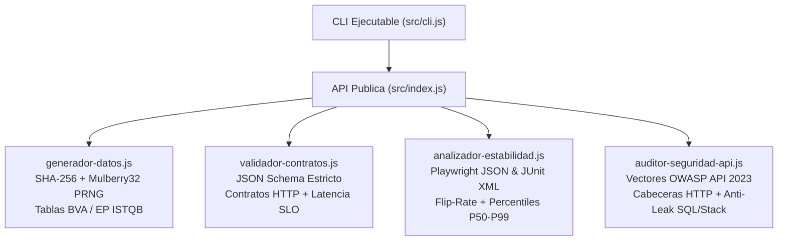

# `@eduardomr1/herramientas-qa` · Kit de Ingeniería de Calidad (Node.js 22)

[](https://github.com/Eduardomr1/proyectos-de-qa/actions/workflows/ci-herramientas-qa.yml)
[](https://nodejs.org/)
[-059669)](#)
[-2563eb)](#)

Biblioteca modular y herramienta de línea de comandos (CLI) construida exclusivamente sobre APIs nativas de **Node.js 22** (`node:crypto`, `node:test`, `node:assert/strict`, `node:fs`) con **cero dependencias externas**, diseñada para estandarizar cuatro pilares críticos de automatización QA e Ingeniería de Confiabilidad:

1. **Generación Determinista de Datos y Análisis de Valores Límite (BVA / EP):** Semillas reproducibles mediante `SHA-256` + `Mulberry32` para replicar fallos de CI exactamente iguales en entorno local.
2. **Validación Estricta de Contratos JSON Schema & Presupuestos HTTP SLA:** Detección temprana de deriva de tipos (`0`/`1` frente a `boolean` como en `BUG-006`), propiedades filtradas no documentadas (`additionalProperties: false`) y violaciones de latencia.
3. **Analizador de Estabilidad de Suites & Flakiness Gate (Playwright JSON & JUnit XML):** Cuantificación de *flip-rate* entre corridas, detección de pruebas que aprueban tras reintento, cálculo de percentiles de duración ($P50, P90, P95, P99$) y compuerta de calidad bloqueante para mantener **0% pruebas intermitentes**.
4. **Auditor Defensivo de Seguridad API (OWASP API Top 10 · 2023):** Catálogo inmutable de vectores de verificación defensiva (`BOLA`, `Broken Auth`, `BOPLA / Mass Assignment`, `Resource Consumption`, `Injection / Prototype Pollution`), auditor de cabeceras HTTP/CORS y detector de fugas de *stack traces* o errores crudos de SQL.

---

## 🏛️ Arquitectura Modular



> 📖 **Justificación arquitectónica:** Consulta [`docs/arquitectura/adr-001-contratos-y-datos-deterministas.md`](../docs/arquitectura/adr-001-contratos-y-datos-deterministas.md).

---

## 🚀 Ejecución Rápida

No requiere `npm install` ni descarga de paquetes de terceros:

```bash
cd herramientas-qa

# Ejecutar la suite completa de pruebas unitarias y de integracion CLI
npm test

# Consultar comandos disponibles en la CLI
node src/cli.js --help
```

---

## 💻 Uso por Línea de Comandos (CLI)

```bash
# 1. Generar tabla formal de Valores Limite [1, 200] (prevencion BUG-003 y BUG-004)
node src/cli.js limites-texto --min 1 --max 200

# 2. Generar credenciales deterministas a partir de un ID de corrida de CI
node src/cli.js credenciales --seed "run-98412" --email mixto --password fuerte

# 3. Validar una respuesta HTTP capturada contra el contrato canonico
node src/cli.js validar-contrato --contrato listaTareasPaginada --archivo ./respuesta.json

# 4. Evaluar compuerta de Cero Flakiness sobre un reporte JSON de Playwright o XML JUnit
node src/cli.js analizar-reporte --archivo ./playwright-report.json --max-flaky 0

# 5. Exportar vectores defensivos OWASP API Security Top 10 (2023)
node src/cli.js vectores-owasp --categoria "API1:2023-BOLA"
```

---

## 🧩 Uso Programático (ES Modules)

```javascript
import {
  crearGeneradorDeterminista,
  generarValoresLimiteTexto,
  validarRespuestaHttp,
  CONTRATOS_GESTOR_TAREAS,
  auditarFugaInformacionError,
} from './src/index.js';

const rng = crearGeneradorDeterminista('semilla-reproducible-2026');
const fronterasTitulo = generarValoresLimiteTexto({ min: 1, max: 200 });

const veredictoContrato = validarRespuestaHttp(
  {
    status: 201,
    headers: { 'Content-Type': 'application/json' },
    tiempoMs: 24,
    cuerpo: {
      id: rng.enteroEntre(1, 500),
      title: fronterasTitulo.find((c) => c.id === 'en-maximo').valor,
      done: false,
      created_at: '2026-11-02T09:30:00Z',
    },
  },
  CONTRATOS_GESTOR_TAREAS.tareaIndividual
);

const veredictoSeguridad = auditarFugaInformacionError({
  status: 401,
  cuerpo: { error: 'Token invalido o expirado' },
});
```

---

## 🧪 Cobertura de Pruebas (`node:test`)

| Archivo de Prueba | Módulos y Reglas Verificadas |
|---|---|
| `tests/generador-datos.test.js` | Reproducibilidad PRNG por semilla, formato RFC 4122 UUIDv4, fronteras exactas de texto/enteros y fixtures de regresión (`BUG-001`, `BUG-003`, `BUG-004`, `BUG-005`, `BUG-007`). |
| `tests/validador-contratos.test.js` | Tipado estricto (`integer` vs `boolean` en `BUG-006`), `additionalProperties: false`, formatos (`jwt`, `uuid`, `email`, `iso-date-time`), códigos HTTP, `204` vacío y SLO de latencia. |
| `tests/analizador-estabilidad.test.js` | Interpolación de percentiles $P50\text{–}P99$, normalización recursiva de suites Playwright y JUnit XML, detección de *flip-rate* multicorrida y compuertas CI. |
| `tests/auditor-seguridad-api.test.js` | Inmutabilidad de las 5 categorías OWASP API 2023, evaluación de cabeceras HTTP/CORS/HSTS y detección de fugas de trazas V8 y errores `SQLITE_ERROR`. |
| `tests/cli.test.js` | Pruebas de integración en subproceso real (`execFileSync`) verificando salida JSON estándar y códigos de salida POSIX (`0` aprobado / `1` bloqueado). |
