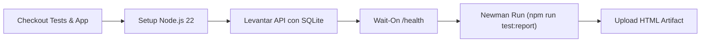

# Automatización de Pruebas de API con Postman y Newman

[](https://github.com/Eduardomr1/proyectos-de-qa/actions/workflows/ci-api-postman.yml)
[](https://www.npmjs.com/package/newman)
[](https://www.npmjs.com/package/newman-reporter-htmlextra)
[](https://nodejs.org/)
[-brightgreen)](#matriz-de-cobertura-de-endpoints-y-aserciones)

Suite integral de pruebas automatizadas de API para la [API del gestor de tareas](https://github.com/eduardo-mr1/proyectos-de-programacion/tree/main/api-gestor-tareas). Esta solución permite validar contratos de API REST, seguridad basada en JWT, reglas de validación de negocio y prevención de regresiones de bugs, ejecutable tanto en la interfaz interactiva de **Postman** como en entornos desatendidos de **CI/CD** y terminal local mediante un **runner configurable con Newman y reportes ejecutivos interactivos en HTML**.

---

## 📊 Métricas Clave de la Suite

- **25 Peticiones HTTP** organizadas en 4 carpetas funcionales.
- **96 Aserciones Ejecutadas** por corrida (47 aserciones específicas + 49 ejecuciones globales transversales).
- **100% Tasa de Aprobación** (0 fallos en la suite de regresión).
- **Tiempo Promedio de Respuesta:** ~25–35 ms en entorno local.
- **Reportes Ejecutivos:** Dashboard HTML interactivo con gráficos de métricas, desglose de peticiones y tiempos de respuesta.

---

## 🚀 Inicio Rápido (Quickstart)

### Requisitos Previos

1. **Node.js 22+** instalado.
2. La API del gestor de tareas levantada en `http://localhost:3000`:
   ```bash
   # En la carpeta de la API (app/api-gestor-tareas)
   npm install
   npm start
   ```

### Instalación y Ejecución

Desde la carpeta `pruebas-api-postman`:

```bash
# 1. Instalar dependencias (Newman y reporter)
npm install

# 2. Ejecutar la suite completa por consola
npm test

# 3. Ejecutar y generar reporte ejecutivo interactivo en HTML
npm run test:report
```

El reporte se genera en `reporte/reporte-ejecutivo.html`. Ábrelo en cualquier navegador web para explorar el dashboard interactivo.

---

## 🛠️ Runner Configurable (`run-tests.js`)

Se diseñó un runner programático sobre la API de Node.js de Newman que estandariza la ejecución, valida la configuración del entorno, captura métricas en tiempo real y ofrece opciones flexibles por CLI o variables de entorno.

### Opciones de Línea de Comandos

| Opción | Alias | Descripción | Valor por Defecto |
|---|---|---|---|
| `--report` | `-r` | Genera reporte HTML interactivo con dashboard (`htmlextra`) | `false` |
| `--no-report` | | Desactiva expresamente la generación de reporte HTML | |
| `--report-path <ruta>` | | Ruta destino del archivo HTML generado | `reporte/reporte-ejecutivo.html` |
| `--collection <ruta>` | `-c` | Ruta al archivo JSON de la colección Postman | `coleccion.json` |
| `--environment <ruta>` | `-e` | Ruta al archivo JSON de variables de entorno | `entorno.local.json` |
| `--folder <nombre>` | `-f` | Ejecuta únicamente una carpeta específica (`Salud`, `Autenticacion`, `Tareas`, `Seguridad`) | Suite completa |
| `--bail` | `-b` | Detiene la ejecución inmediatamente tras el primer fallo | `false` |
| `--iterations <n>` | `-n` | Número de iteraciones a ejecutar | `1` |
| `--base-url <url>` | | Sobrescribe la URL base de la API en caliente | De `entorno.local.json` |
| `--delay <ms>` | | Pausa en milisegundos entre peticiones | `0` |
| `--timeout <ms>` | | Timeout máximo por petición en ms | `10000` |
| `--env-var <k=v>` | | Sobrescribe o inyecta variables al entorno | |
| `--help` | `-h` | Despliega el menú de ayuda y ejemplos | |

### Variables de Entorno Compatibles

El runner también responde a variables de entorno para integración fluida en contenedores o runners de CI:

- `REPORT=true` o `GENERATE_REPORT=true`
- `REPORT_PATH=ruta/al/reporte.html`
- `BASE_URL=http://api.staging.internal:3000`
- `TEST_FOLDER=Autenticacion`
- `BAIL=true`
- `COLLECTION_PATH` / `ENVIRONMENT_PATH`

### Scripts npm Disponibles

| Script | Comando Equivalente | Propósito |
|---|---|---|
| `npm test` | `node run-tests.js` | Ejecución estándar con salida estructurada en consola |
| `npm run test:api` | `node run-tests.js` | Alias descriptivo para CI/CD y scripts de orquestación |
| `npm run test:report` | `node run-tests.js --report` | Ejecuta toda la suite y genera el dashboard HTML ejecutivo |
| `npm run test:reporte` | `node run-tests.js --report` | Alias en español para retrocompatibilidad |
| `npm run test:cli` | `node run-tests.js --no-report` | Fuerza salida exclusiva por consola |
| `npm run test:salud` | `node run-tests.js --folder Salud` | Ejecuta únicamente el smoke check de disponibilidad |
| `npm run test:auth` | `node run-tests.js --folder Autenticacion` | Ejecuta los 9 casos del módulo de autenticación |
| `npm run test:tareas` | `node run-tests.js --folder Tareas` | Ejecuta los 11 casos del módulo CRUD de tareas |
| `npm run test:seguridad` | `node run-tests.js --folder Seguridad` | Ejecuta los 4 casos de seguridad y control de acceso |
| `npm run test:bail` | `node run-tests.js --bail` | Modo de fallo rápido (detiene al primer error) |
| `npm run newman:cli` | `newman run ... --reporters cli` | Ejecución directa vía CLI nativo de Newman |
| `npm run newman:report` | `newman run ... --reporters cli,htmlextra` | Ejecución directa vía CLI con htmlextra nativo |

---

## 🎯 Estrategia de Pruebas de API

La suite de pruebas adopta un enfoque estratificado orientado a validar la robustez de la API ante cualquier cliente HTTP:

```
                  ▲
                 / \     [E2E: Playwright]
                /   \    Flujos completos de usuario en navegador
               /=====\
              /       \  [API: Postman / Newman] (Esta Suite)
             /         \ Contratos REST, Códigos HTTP, JWT, Reglas y Bugs
            /===========\
           /             \ [Integración / Unitaria: node:test]
          /               \ Lógica interna y persistencia SQLite
         ───────────────────
```

### Principios del Diseño

1. **Aserciones Globales Transversales:**
   Definidas en el script raíz de la colección para asegurar estándares consistentes en toda la API:
   - **SLA de Latencia:** Cada respuesta debe completarse en menos de 2,000 ms (`responseTime < 2000`).
   - **Formato del Contrato:** Todas las respuestas deben devolver un JSON válido (`pm.response.to.be.json`), exceptuando el código HTTP `204 No Content` (eliminación de tareas).
2. **Encadenamiento y Estado Dinámico (Zero-Fixture Dependency):**
   - El script pre-request genera un correo aleatorio irrepetible:
     ```javascript
     pm.environment.set('email', `qa_${Date.now()}@postman.local`);
     ```
   - Al registrar la cuenta, el token JWT generado se almacena dinámicamente en `{{token}}`.
   - Las peticiones subsecuentes reutilizan `{{token}}` en el encabezado `Authorization: Bearer {{token}}`.
   - La creación de la tarea almacena su `id` en `{{taskId}}`, habilitando las pruebas de actualización (`PATCH`) y eliminación (`DELETE`) sin dependencias de datos fijos.
3. **Validación Exhaustiva de Contratos y Tipos:**
   No basta con recibir un código `200` o `201`; se inspeccionan tipos de datos (`boolean`, `string`, `number`), presencia de claves obligatorias y estructura de paginación.
4. **Prevención Directa de Regresiones (Mapeo de Bugs):**
   Cada defecto documentado en el [reporte de bugs](../reporte-de-bugs) cuenta con una o más aserciones dedicadas para garantizar que el defecto no reaparezca.

---

## 📋 Matriz de Cobertura de Endpoints y Aserciones

La colección abarca **25 escenarios** con un total de **96 aserciones ejecutadas**:

| Carpeta | Método | Endpoint | Caso de Prueba / Escenario | Aserciones Específicas Validadas | Aserciones Globales | Código | Bug Asignado |
|---|---|---|---|---|---|:---:|:---:|
| **Salud** | `GET` | `/health` | Verificación de disponibilidad de la API | • Responde 200<br>• Reporta estado 'ok'<br>• Tiempo < 500 ms | < 2s, JSON | `200` | — |
| **Autenticación** | `POST` | `/auth/register` | Registro exitoso de nueva cuenta | • Responde 201<br>• Devuelve token<br>• Token con 3 partes de JWT | < 2s, JSON | `201` | — |
| **Autenticación** | `POST` | `/auth/register` | Rechazo de email duplicado | • Responde 409<br>• Explica el motivo del conflicto | < 2s, JSON | `409` | — |
| **Autenticación** | `POST` | `/auth/register` | Email insensible a mayúsculas | • Email en mayúsculas detectado como duplicado | < 2s, JSON | `409` | **BUG-001** |
| **Autenticación** | `POST` | `/auth/register` | Rechazo de contraseña común | • Responde 400<br>• Mensaje indica contraseña común | < 2s, JSON | `400` | **BUG-005** |
| **Autenticación** | `POST` | `/auth/register` | Rechazo de contraseña demasiado corta | • Responde 400 por validación de longitud | < 2s, JSON | `400` | — |
| **Autenticación** | `POST` | `/auth/register` | Rechazo de email mal formado | • Responde 400 por formato inválido | < 2s, JSON | `400` | — |
| **Autenticación** | `POST` | `/auth/login` | Inicio de sesión exitoso con credenciales válidas | • Responde 200 con token | < 2s, JSON | `200` | — |
| **Autenticación** | `POST` | `/auth/login` | Inicio de sesión con email en mayúsculas | • Responde 200 normalizando mayúsculas | < 2s, JSON | `200` | **BUG-001** |
| **Autenticación** | `POST` | `/auth/login` | Rechazo de contraseña incorrecta | • Responde 401<br>• No filtra existencia previa de cuenta | < 2s, JSON | `401` | — |
| **Tareas** | `POST` | `/tasks` | Creación exitosa de tarea | • Responde 201<br>• Título coincide<br>• `done` booleano y arranca en `false`<br>• Incluye `id` y `created_at` | < 2s, JSON | `201` | **BUG-006** |
| **Tareas** | `POST` | `/tasks` | Recorte de espacios en título | • Responde 201<br>• Título guardado sin espacios extras | < 2s, JSON | `201` | **BUG-004** |
| **Tareas** | `POST` | `/tasks` | Rechazo de título con solo espacios en blanco | • Responde 400 por contenido vacío | < 2s, JSON | `400` | **BUG-004** |
| **Tareas** | `POST` | `/tasks` | Rechazo de título que supera límite máximo | • Responde 400<br>• Mensaje menciona límite de caracteres | < 2s, JSON | `400` | **BUG-003** |
| **Tareas** | `GET` | `/tasks?limit=10&offset=0` | Consulta de lista de tareas paginada | • Responde 200<br>• Estructura paginada (`tasks`, `total`, `limit`, `offset`)<br>• Total exacto del usuario<br>• Respeta `limit`<br>• Campo `done` es booleano | < 2s, JSON | `200` | **BUG-007**<br>**BUG-006** |
| **Tareas** | `GET` | `/tasks?limit=9999` | Rechazo de `limit` fuera de rango permitido | • Responde 400 por valor excesivo | < 2s, JSON | `400` | **BUG-007** |
| **Tareas** | `PATCH` | `/tasks/:id` | Marcar tarea como completada | • Responde 200<br>• `done` actualizado a `true` como booleano | < 2s, JSON | `200` | **BUG-006** |
| **Tareas** | `PATCH` | `/tasks/:id` | Modificar título de una tarea existente | • Responde 200<br>• Actualiza título<br>• Conserva estado `done` previo | < 2s, JSON | `200` | — |
| **Tareas** | `PATCH` | `/tasks/:id` | Intento de modificar tarea con ID inexistente | • Responde 404 Not Found | < 2s, JSON | `404` | — |
| **Tareas** | `DELETE` | `/tasks/:id` | Eliminación exitosa de tarea | • Responde 204 No Content<br>• Cuerpo de respuesta estrictamente vacío | < 2s | `204` | — |
| **Tareas** | `DELETE` | `/tasks/:id` | Intento de eliminar una tarea ya borrada | • Responde 404 al intentar segundo borrado | < 2s, JSON | `404` | — |
| **Seguridad** | `GET` | `/tasks` | Acceso a tareas sin cabecera de autenticación | • Responde 401<br>• Mensaje indica token ausente | < 2s, JSON | `401` | — |
| **Seguridad** | `GET` | `/tasks` | Acceso con token JWT inválido/adulterado | • Responde 401 Unauthorized | < 2s, JSON | `401` | — |
| **Seguridad** | `GET` | `/tasks` | Acceso con esquema mal formado (sin 'Bearer ') | • Responde 401<br>• Exige prefijo Bearer | < 2s, JSON | `401` | — |
| **Seguridad** | `GET` | `/ruta-inexistente` | Acceso a endpoint inexistente en el servidor | • Responde 404<br>• Retorna respuesta JSON estructurada (no HTML) | < 2s, JSON | `404` | — |

---

## 📈 Reporte Ejecutivo Interactivo (`newman-reporter-htmlextra`)

Cuando se ejecuta con `npm run test:report`, Newman genera un reporte HTML autocontenido con diseño moderno y métricas analíticas:

### Características del Reporte

- **Dashboard de Cabecera:** Gráfico circular de estado (Pass/Fail), tasa de éxito, total de aserciones, peticiones y tiempo total de ejecución.
- **Pestaña de Peticiones y Respuestas:** Inspección detallada de headers enviados/recibidos, cuerpos JSON, códigos de estado y tiempos individuales.
- **Paginación y Filtrado:** Búsqueda rápida por nombre de endpoint, código de respuesta o estado de aserción (incluye filtro de sólo fallos).
- **Protección de Datos:** Omisión automática de valores sensibles de entorno.
- **Zona Horaria y Tiempos:** Tiempos de respuesta formateados con zona horaria local.

```bash
# Generar y ver el reporte:
npm run test:report

# Ruta del archivo generado:
reporte/reporte-ejecutivo.html
```

---

## 🔄 Integración Continua (CI/CD) en GitHub Actions

Las pruebas se ejecutan de manera totalmente automatizada en el pipeline [`.github/workflows/ci-api-postman.yml`](../.github/workflows/ci-api-postman.yml) en cada `push` y `pull_request` que afecte a esta suite:



### Pasos del Pipeline:

1. **Checkout Cruzado:** Clona la suite de pruebas y la aplicación (`api-gestor-tareas`).
2. **Ambiente:** Configura Node.js 22.
3. **Inicio del Servicio:** Instala dependencias del backend, inicia el servidor en segundo plano (`npm start &`) y espera a que el endpoint de salud esté listo mediante `npx wait-on http://localhost:3000/health --timeout 60000`.
4. **Ejecución de Pruebas:** Instala paquetes y corre `npm run test:report`.
5. **Publicación del Reporte:** Usa `actions/upload-artifact@v4` para archivar `reporte-ejecutivo-api-newman` por 14 días con acceso para descarga directa por parte del equipo técnico.

---

## 🖥️ Uso desde la Interfaz de Postman (GUI)

Para explorar o ejecutar interactivamente la colección desde Postman:

1. Abre la aplicación de **Postman**.
2. Presiona el botón **Import** (esquina superior izquierda).
3. Selecciona y arrastra el archivo `coleccion.json`.
4. Importa también el archivo `entorno.local.json` como un **Environment**.
5. Selecciona el entorno **Local** en el selector superior derecho.
6. Haz clic derecho sobre la colección **API Gestor de Tareas** y selecciona **Run collection**.
7. Selecciona las iteraciones deseadas y presiona **Run API Gestor de Tareas**.

---

## ⚠️ Limitaciones Conocidas y Alcance

- **Limitador de Tasa en Login (Rate Limiting):** No se evalúa el bloqueo tras 5 intentos fallidos en esta suite para evitar bloquear la dirección o el usuario durante 15 minutos en ejecuciones locales compartidas. Esa validación se encuentra cubierta en las pruebas de regresión con base de datos en memoria del repositorio de la API.
- **Pruebas de Carga y Concurrencia:** Newman ejecuta peticiones de manera secuencial. Para evaluar comportamiento bajo alto estrés o pruebas de concurrencia distribuida, se recomienda el uso de herramientas como **k6** o **JMeter**.
